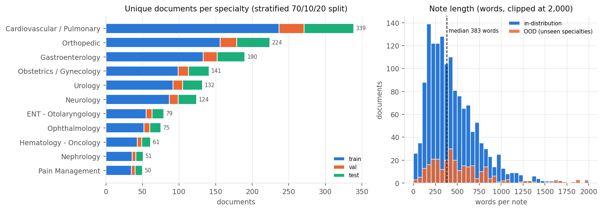
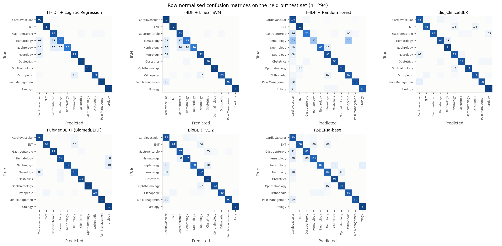
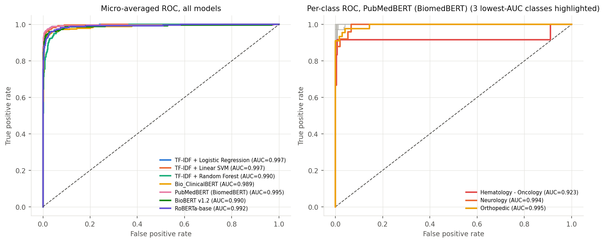
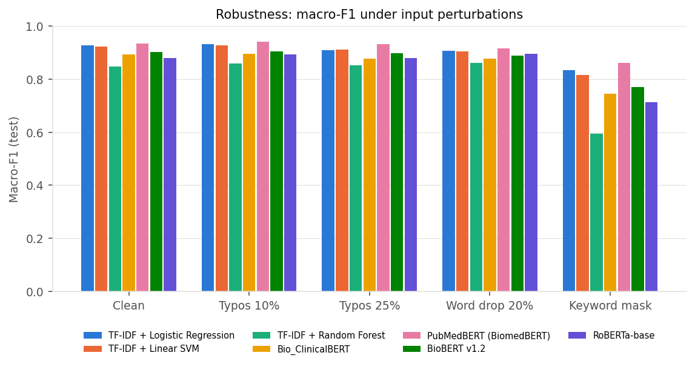
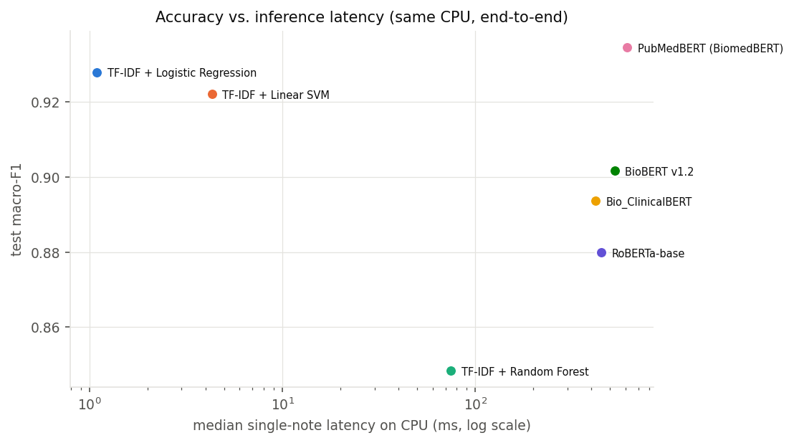
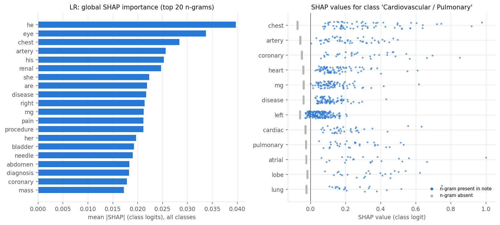
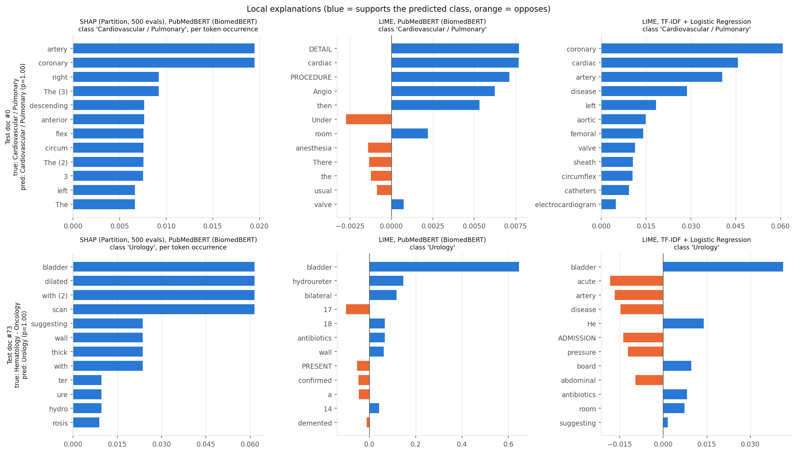
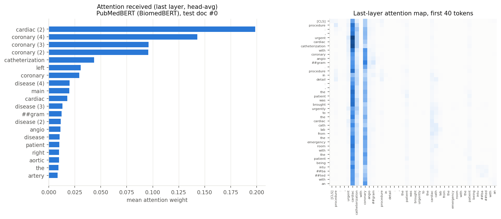

# Transformer-Based Model Evaluation for Medical Text Classification and Clinical Decision Support

**Albert Kabore**  
**PhD student in AI at the University of the Cumberlands**  
November 24, 2026

## Abstract

Seven classifiers were compared on medical specialty classification: Logistic Regression, linear SVM, Random Forest, BioBERT, Bio_ClinicalBERT, PubMedBERT, and RoBERTa. Duplicate grouping and label filtering reduced the MTSamples dataset to 1,466 documents across 11 specialties; 279 notes from unseen specialties provided an additional robustness test. Evaluation covered classification performance, statistical uncertainty, corrupted inputs, demographic proxies, inference cost, and explanations. CPU limits restricted transformer fine-tuning to the final two encoder layers and classification head. PubMedBERT achieved the highest test macro-F1, 0.9347, with 94.22% accuracy. Logistic Regression reached macro-F1 0.9280 and accuracy 93.88%. Their paired macro-F1 difference was 0.0067, with a 95% bootstrap interval from −0.0300 to 0.0451. The difference remains statistically unresolved. Logistic Regression was faster and better at detecting unseen specialties. These results support further specialty-routing research; diagnosis accuracy and patient benefit were not measured.

## Introduction

Medical specialty classification could help staff route transcriptions, organize work queues, and retrieve relevant records. Each model in this study receives a note and predicts one of 11 specialty labels. Those labels do not establish a diagnosis, so the study evaluates document classification as a possible component of clinical decision support.

Healthcare evaluation must account for errors that an average score can hide. Duplicate notes can inflate test performance, small specialties may receive poor predictions, and a confident mistake can be difficult for a user to recognize. The comparison therefore examines classification scores alongside robustness, demographic differences, explanations, and computational cost. Model selection is based on the measured behavior of the fitted systems under the stated training constraints.

## Methodology

### Dataset and cleaning

The source is the Kaggle Medical Transcriptions dataset, distributed from MTSamples (tboyle10, n.d.). The raw CSV contains 4,999 rows and 40 category labels. Cleaning removes rows without transcription text, trims text and labels, and groups identical transcriptions before any split.

| Stage | Count | Treatment |
|---|---:|---|
| Raw rows | 4,999 | Starting dataset |
| Missing transcriptions | 33 | Removed |
| Nonmissing rows | 4,966 | Grouped by stripped transcription text |
| Unique transcriptions | 2,357 | 2,609 repeated rows grouped |
| Documents with one retained specialty | 1,745 | Eligible for the specialty task |
| Documents with multiple retained specialties | 317 | Excluded as ambiguous |
| Documents without a retained specialty | 295 | Excluded |
| Main classification set | 1,466 | 11 specialties with at least 50 unique notes each |
| Unseen-specialty set | 279 | 19 less frequent specialties, excluded from training |

*Table 1. Dataset selection and duplicate resolution.*

The label policy excludes Surgery, Consult - History and Phy., SOAP / Chart / Progress Notes, Discharge Summary, Office Notes, Letters, Emergency Room Reports, IME-QME-Work Comp etc., General Medicine, and Radiology. Some are document categories; others are legitimate clinical fields excluded to define this benchmark. Only documents with exactly one remaining specialty are retained. Excluding ambiguous cases narrows the clinical workload represented by the results.

Regex screening replaces selected identifiers. Across the 1,745 retained notes, it matched 880 date strings, 334 titled names, and one phone number. A dictionary of 34 abbreviations produced 692 expansions. Punctuation artifacts and repeated whitespace were normalized. Abbreviation meanings and complete PHI removal have not been clinically validated.

{{cleaning_audit}}

Stratified splitting with seed 42 gives 1,025 training, 147 validation, and 294 test notes. The largest class contains 339 documents and the smallest 50, a ratio of 6.78:1. Logistic Regression and SVM use balanced class weights, Random Forest uses `balanced_subsample`, and transformers use class-weighted cross-entropy. No oversampling is applied to the test set.

### Models and text representation

The comparison includes three traditional models and four transformer encoders. BERT supplies the encoder architecture (Devlin et al., 2019); BioBERT and Bio_ClinicalBERT adapt it to biomedical literature and clinical notes (Lee et al., 2020; Alsentzer et al., 2019). PubMedBERT uses biomedical pre-training and vocabulary, while RoBERTa provides a general-domain comparison (Gu et al., 2021; Liu et al., 2019).

| Model | Representation | Input | Fitted components |
|---|---|---|---|
| Logistic Regression | TF-IDF; multinomial linear classifier | Full note | Classifier weights |
| Linear SVM | TF-IDF; linear maximum-margin classifier | Full note | Five classifier/calibrator pairs |
| Random Forest | Up to 20,000 TF-IDF unigram and bigram features | Full note | Selected ensemble of 300 trees |
| BioBERT v1.2 | Cased WordPiece; biomedical BERT | First 256 tokens | Top two encoder layers and head |
| Bio_ClinicalBERT | Cased WordPiece; clinical adaptation of BioBERT | First 256 tokens | Top two encoder layers and head |
| PubMedBERT / BiomedBERT | Biomedical uncased WordPiece vocabulary | First 256 tokens | Top two encoder layers and head |
| RoBERTa-base | Byte-level BPE; general-domain pre-training | First 256 tokens | Top two encoder layers and head |

*Table 2. Architectures and input scope.*

The checkpoints are `dmis-lab/biobert-base-cased-v1.2`, `emilyalsentzer/Bio_ClinicalBERT`, `microsoft/BiomedNLP-BiomedBERT-base-uncased-abstract-fulltext`, and `FacebookAI/roberta-base`. Microsoft's model card documents the PubMedBERT-to-BiomedBERT name change (Microsoft, n.d.). Each encoder has 12 layers, hidden size 768, and 12 attention heads.

TF-IDF is fitted within each training fold, using sublinear term frequency, minimum document frequency 2, and maximum document frequency 90%. BioBERT and Bio_ClinicalBERT preserve case; PubMedBERT uses uncased tokenization. In a 30-term vocabulary check, PubMedBERT kept 23 clinical terms whole and BioBERT kept one. Median training-note lengths were 534 and 672 tokens, respectively, exceeding the 256-token limit.

### Training and experiment tracking

Classical hyperparameters are selected by five-fold stratified cross-validation on the training split, maximizing mean macro-F1. Each search fold refits the complete TF-IDF pipeline.

| Model | Search space | Selected settings | CV macro-F1 |
|---|---|---|---:|
| Logistic Regression | C = 1, 10, 100, 1000; unigrams or unigrams plus bigrams | C = 100; unigrams | 0.8888 |
| Linear SVM | C = 0.1, 0.5, 1, 5; same n-gram options | C = 0.5; unigrams | 0.8956 |
| Random Forest | 300 or 600 trees; max_features = sqrt or 0.05; minimum leaf size = 1 or 2 | 300 trees; sqrt; minimum leaf size 2 | 0.8199 |

*Table 3. Classical model searches and selected configurations.*

SVM probabilities come from five-fold sigmoid calibration after hyperparameter selection. TF-IDF was fitted on the entire training split before those calibration folds. Validation and test notes remained outside the fit, but vocabulary and inverse document frequencies were shared across calibration folds. The SVM search score describes the uncalibrated classifier.

Training used an Intel Core i3-N305 CPU with eight threads and no GPU. Transformer embeddings and the bottom ten layers were frozen in evaluation mode. Their outputs were cached in float16; the top two layers and a masked-mean-pooling, dropout, and linear head were trained, approximately 14.2 million parameters. Float16 caching introduces rounding. Partial fine-tuning has precedent in Lee et al. (2019), but its performance relative to full fine-tuning was not measured here.

All four transformers use batch size 16, maximum length 256 tokens including special tokens, AdamW with weight decay 0.01, 10% linear warm-up, linear learning-rate decay, and gradient clipping at norm 1.0. The learning-rate grid is {0.00003, 0.0001}. Early stopping monitors validation macro-F1 with patience two and a six-epoch limit, restoring the best checkpoint. One seed, 42, was used. These neural-network controls do not apply to the classical estimators.

| Transformer | Selected learning rate | Best epoch | Validation macro-F1 |
|---|---:|---:|---:|
| BioBERT | 0.0001 | 5 | 0.8863 |
| Bio_ClinicalBERT | 0.00003 | 5 | 0.9096 |
| PubMedBERT | 0.0001 | 6 | 0.9358 |
| RoBERTa | 0.0001 | 4 | 0.8533 |

*Table 4. Selected transformer checkpoints.*

MLflow stores run parameters and epoch metrics. Saved histories document the selected checkpoints. A Logistic Regression ablation uses the text prefix corresponding to Bio_ClinicalBERT's first 256 tokens; it controls input length for that tokenizer, rather than matching every transformer's prefix exactly.

### Evaluation protocol

The held-out evaluation reports accuracy, macro precision, recall and F1, weighted F1, and one-versus-rest ROC-AUC. Expected calibration error (ECE) uses 15 equal-width confidence bins (Guo et al., 2017). Percentile intervals use 1,000 document bootstrap samples with fitted models held fixed. Paired macro-F1 intervals are pointwise and exclude variation from retraining and model selection.

The reference model is selected by validation macro-F1. McNemar's test compares paired correctness, using an exact binomial test below 25 discordant pairs and continuity-corrected chi-square otherwise. Holm correction covers all 21 architecture pairs. Additional resampling uses the 1,172 training-plus-validation notes: Dietterich's five-by-two paired t-test and a Nadeau–Bengio-style corrected t approximation for ten-fold scores (Dietterich, 1998; Nadeau & Bengio, 2003). Transformer resampling evaluates frozen embeddings with standardized Logistic Regression probes, not repeated fine-tuning.

Robustness tests introduce typos with probabilities 0.10 and 0.25, delete words with probability 0.20, or mask 164 terms drawn from the top 15 Logistic Regression unigram coefficients per class. Each condition has one generated version. Masking targets the linear model and transfers to the other models; clinicians did not verify that corrupted notes preserved their meaning.

Unseen-specialty detection uses maximum predicted class probability (Hendrycks & Gimpel, 2017). The fifth percentile of in-distribution test confidence defines an approximate 95% true-positive operating point. OOD FPR is the fraction of unseen-specialty notes incorrectly accepted at that threshold. The unseen notes share the dataset source, and the test-derived threshold is descriptive rather than a deployment setting.

Sex and age groups are inferred from text cues. Demographic parity compares predicted label frequencies between groups; equal opportunity compares class-specific true-positive rates (Hardt et al., 2016). A class enters the latter comparison only when each group has at least five notes. Automated gendered-word swaps provide a separate sensitivity check.

Efficiency is measured in fresh processes on the same CPU: 30 single-note predictions after one warm-up call, and throughput on 64 notes. Timing includes feature extraction or tokenization of cleaned text. Peak process memory includes loading and temporary allocations. Classical storage measurements use compressed joblib pipelines; transformer state dictionaries exclude tokenizer files and software dependencies. Sizes are reported in MiB.

Interpretability uses linear SHAP with 500 background training notes for Logistic Regression, expressed in class logits (Lundberg & Lee, 2017). Two PubMedBERT test notes receive SHAP Partition explanations with a 500-evaluation budget and LIME with 300 perturbations; baseline LIME uses 1,000 samples (Ribeiro et al., 2016). Attention is visualized as model computation, without treating its weights as a faithful explanation (Jain & Wallace, 2019).

The review rebuilt the data from the raw CSV and checked metrics and statistical tests against saved predictions. Transformer training and hardware measurements were not repeated during the review.

## Results

### Classification performance

{{table:performance|Model,Accuracy,Macro-P,Macro-R,Macro-F1,Weighted-F1,ROC-AUC (macro OvR),ECE|4}}

*Table 5. Held-out performance as proportions. The final row is an input-length ablation.*

PubMedBERT correctly classified 277 of 294 notes; Logistic Regression and SVM each classified 276. PubMedBERT's macro-F1 interval is [0.898, 0.963], compared with [0.887, 0.958] for Logistic Regression. Rankings depend on the metric: Logistic Regression has higher macro ROC-AUC, while Bio_ClinicalBERT has the lowest ECE.

Restricting Logistic Regression to the 256-token prefix lowers macro-F1 from 0.9280 to 0.8811. Information later in a note appears useful to that model, although tokenizer differences prevent a complete separation of architecture and input-length effects.

### Statistical comparisons

| Accuracy comparison | First correct / second wrong | First wrong / second correct | Raw p | Holm-adjusted p |
|---|---:|---:|---:|---:|
| Logistic Regression vs. PubMedBERT | 8 | 9 | 1.0000 | 1.0000 |
| SVM vs. PubMedBERT | 7 | 8 | 1.0000 | 1.0000 |
| Random Forest vs. PubMedBERT | 9 | 33 | 0.000387 | 0.007735 |
| PubMedBERT vs. RoBERTa | 18 | 4 | 0.004344 | 0.078183 |

*Table 6. Selected McNemar comparisons; adjustment covers all 21 pairs.*

After Holm correction, only Logistic Regression, SVM, and PubMedBERT versus Random Forest fall below p = .05. The other comparisons do not establish an accuracy difference. Failure to reject a difference does not establish equivalence.

{{table:paired_bootstrap|reference,vs,delta macro-F1,95% CI low,95% CI high|4}}

*Table 7. PubMedBERT minus comparator macro-F1, with pointwise paired-bootstrap intervals.*

The PubMedBERT–Logistic Regression interval crosses zero, as does the SVM interval. Some intervals against weaker models exclude zero, but these use macro-F1 without multiplicity adjustment. They answer a different question from Holm-adjusted McNemar testing. The saved bootstrap tail fraction is not interpreted as a calibrated p-value.

{{table:cv_summary||4}}

*Table 8. Resampled macro-F1. Rows marked `_frozen` are embedding probes rather than the final transformer classifiers.*

SVM has the highest ten-fold mean, 0.9125, followed by Logistic Regression at 0.9048. Their five-by-two and corrected ten-fold raw p-values are 0.5440 and 0.2168; both adjusted p-values are 1.000. Previously selected hyperparameters overlap with the resampling pool, so these scores are not nested estimates of the full search procedure. SVM resampling also omits its final calibration ensemble.

### Robustness and unseen specialties

{{table:robustness|Model,clean,typo_10,typo_25,word_drop_20,keyword_mask,OOD AUROC (MSP),OOD FPR@95TPR|4}}

*Table 9. Perturbation macro-F1 and unseen-specialty detection. Higher AUROC and lower OOD FPR are preferable.*

Keyword masking causes the largest consistent classification losses. PubMedBERT falls from 0.9347 to 0.8615; Logistic Regression falls from 0.9280 to 0.8346. Slight gains under some mild corruptions depend on a single altered test set and do not show that corruption helps in general.

Logistic Regression separates known from unseen specialties better, with OOD AUROC 0.9139 against PubMedBERT's 0.8414. At the reported threshold, they accept 45.88% and 65.95% of unseen notes, respectively. PubMedBERT's mean maximum probability on those notes is 0.8455, despite their correct specialties being absent from the trained label set.

### Demographic proxies and sensitivity

{{table:fairness|Model,attribute,group A,acc A,group B,acc B,DP diff (max over classes),EO gap max !dTPR!,EO classes evaluated|4}}

*Table 10. Demographic parity (DP), equal opportunity (EO), and subgroup accuracy using inferred attributes.*

The test set contains 89 female-coded, 91 male-coded, and 114 unknown-sex notes. Age extraction identifies 74 notes aged 18–64, 44 aged 65 or older, and 14 younger than 18; 162 remain unknown. EO comparisons cover four classes for sex proxies and three for adult age.

PubMedBERT accuracy is 91.01% on female-coded notes and 93.41% on male-coded notes. Its maximum EO gaps are 0.1667 for sex proxies and 0.1000 for adult age. The sex-proxy DP maximum equals the largest true-label frequency gap, 0.1913. Equality of these maxima does not show that each class has matching disparities.

{{table:counterfactual_gender_swap|Model,flips (n),flip rate (all),macro-F1 swapped|4}}

*Table 11. Prediction changes after automated gendered-word swaps on all 294 test notes.*

PubMedBERT changes one prediction, Logistic Regression nine, and RoBERTa ten. The substitutions can create medically inconsistent text, so the result measures sensitivity rather than causal counterfactual fairness.

### Efficiency

{{table:efficiency|Model,latency median (ms),latency p95 (ms),throughput (docs/s),peak memory (MB),serialized size (MB)|2}}

*Table 12. Recorded CPU inference cost. Storage and process memory are in MiB.*

Logistic Regression's median latency is approximately 562 times lower than PubMedBERT's in this measurement. Dynamic int8 quantization reduces PubMedBERT latency to 343.60 ms and storage to 173.08 MiB, but macro-F1 falls to 0.8813 and peak memory rises to 1,170.42 MiB. The tested compression trades away accuracy and does not reduce the recorded peak process memory.

End-to-end float32 predictions match the cached pipeline's labels on all 294 test notes for each transformer. Probabilities can still differ. Hardware measurements come from one machine and one sequence of runs, without uncertainty intervals or concurrent-load tests.

### Interpretability and error analysis

Cardiovascular SHAP rankings emphasize chest, artery, and coronary. These associations describe the fitted model relative to its background data. They do not establish clinical causes or probability changes.

Note 73 is labeled Hematology - Oncology, but PubMedBERT predicts Urology with probability 0.9956. Logistic Regression predicts Gastroenterology with probability 0.3194. Two selected explanations cannot establish explanation quality across the dataset.

PubMedBERT makes 17 test errors. Six exceed 0.90 confidence; mean maximum probability is 0.7821 on errors and 0.9860 on correct predictions. Cardiovascular / Pulmonary to Neurology, the reverse direction, and Orthopedic to ENT - Otolaryngology each occur twice.

{{table:per_class_f1|Unnamed: 0,TF-IDF + Logistic Regression,PubMedBERT (BiomedBERT),support|4}}

*Table 13. Per-specialty F1 and test support for the leading baseline and transformer.*

Hematology - Oncology has only 12 test notes and is difficult for both models. PubMedBERT scores higher on Gastroenterology; Logistic Regression scores higher on ENT and Urology. Perfect F1 on a small class does not establish reliable clinical performance.

## Discussion

The main choice is between a small observed classification gain and a large difference in running cost. PubMedBERT leads macro-F1 and performs better under keyword masking, while Logistic Regression offers faster inference, smaller storage, and better unseen-specialty detection. The paired comparisons leave the leading models' accuracy and macro-F1 differences unresolved. A universal winner is not established by this test set.

Confident errors and poor rejection of unseen specialties matter for routing. A high probability can accompany an incorrect specialty, including when no trained label is appropriate. Any supervised trial should measure misrouting costs and the workload created by abstention. Thresholds would need to be chosen on separate validation data before external testing.

The fairness results cover only part of the population. Demographic cues may describe someone other than the patient, and many notes lack usable age or sex information. Sparse class-by-group samples and different specialty base rates further limit interpretation. Race, ethnicity, language, socioeconomic status, and intersectional groups were not assessed. The observed gaps cannot establish that any model is fair.

Explanations can help reviewers investigate an error, but their usefulness was not tested with clinicians. Linear SHAP expresses feature contributions under a chosen background distribution. Transformer SHAP and LIME cover two notes, and attention is not treated as an explanation. These outputs do not establish clinical reasoning or justify trusting an individual prediction.

### Clinical use and further evaluation

Logistic Regression is the practical starting point for a latency-sensitive, supervised routing trial after external validation. PubMedBERT should remain a comparison candidate because of its higher observed macro-F1 and keyword-mask performance. The tested int8 version should not be selected on speed alone: its F1 loss is substantial, and its measured peak memory is higher.

The next evaluation should include clinically reviewed notes from other hospitals and time periods, with patient or document families kept together where identifiers permit. Repeated training seeds, longer inputs, and nested tuning would address uncertainty left by the current design. The calibrated SVM pipeline should be resampled as a complete system, including TF-IDF fitting inside calibration folds. More labeled Hematology - Oncology examples would improve assessment of the smallest difficult class.

Privacy review must check identifiers the regex rules may miss and abbreviations that may have been expanded incorrectly. Verified demographic fields are needed for a stronger fairness audit. During any trial, staff should be able to correct routing, refer uncertain cases for review, and withdraw the model if errors exceed agreed limits. These controls are consistent with the World Health Organization's guidance on oversight, transparency, accountability, and equity (World Health Organization, 2021).

### Limitations

The test set has 294 notes from one public sample corpus. Ambiguous and uncommon labels were removed from the main task, and semantic near duplicates or shared templates have not been ruled out. Patient, institution, and date information is insufficient for reliable grouped or temporal validation. Complete de-identification and overlap with model pre-training material remain unverified.

Transformer training uses one seed, two learning rates, partial fine-tuning, and short inputs. Frozen probes do not measure variation between fine-tuned runs. Classical resampling uses previously selected settings, and timing results are hardware specific. No study of diagnosis correctness, patient outcomes, or clinician benefit was performed.

## Conclusion

PubMedBERT is the highest-scoring classifier under the tested training budget, with macro-F1 0.9347 and accuracy 94.22%. Its advantage over Logistic Regression and SVM is not statistically established. Logistic Regression reaches macro-F1 0.9280 with much lower CPU latency and better unseen-specialty detection, making it the stronger efficiency candidate.

Both models warrant external specialty-routing evaluation before clinical use. A supervised trial should retain staff review and measure abstention, misrouting, demographic differences, and workload. Further research should repeat training, test longer inputs, improve unseen-specialty rejection, and assess clinically adjudicated targets. The present results do not support autonomous diagnosis or claims of patient benefit.

## References

{{references}}
